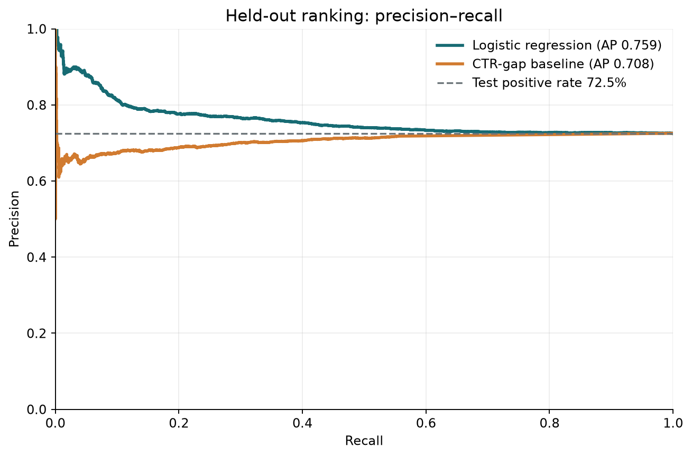
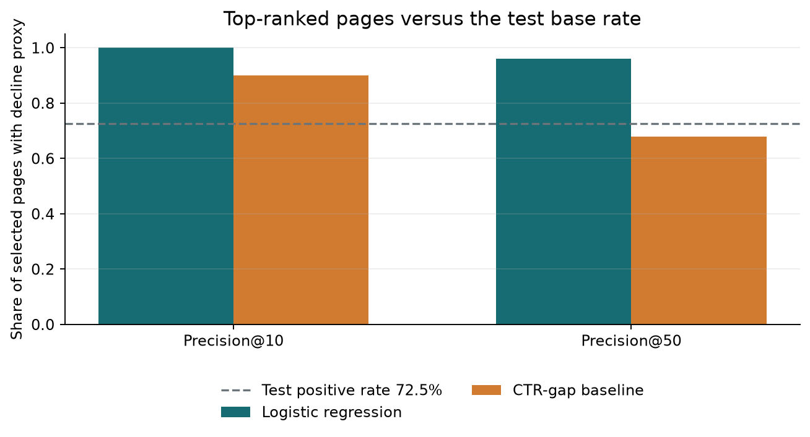
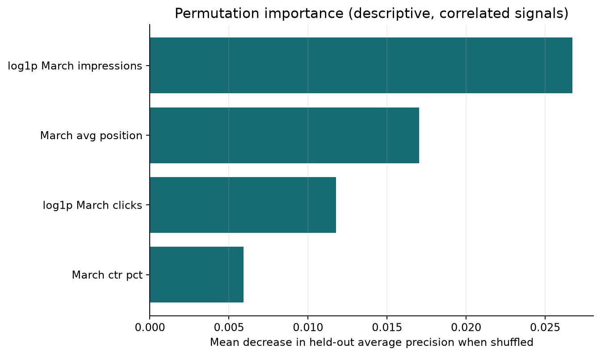

# Capstone Report — Search Decline Risk and CTR Review

- **Author:** Imam Hossain Safin
- **Lane:** CTR / Engagement Opportunity Scoring
- **Repo:** https://github.com/Safin44/my-flyrank-ml-internship
- **Date:** 2026-10-28

## 0. Abstract

This capstone asks whether a small, interpretable model can rank content items whose clicks fall in the month after a March 2026 decision snapshot. It uses the FlyRank anonymized warehouse daily-performance table, aggregating March features and April outcomes for 63,498 eligible items from 35 clients. A class-balanced logistic regression uses March-only impressions, clicks, click-through rate, and average position, and is compared with a transparent within-position CTR-shortfall rule on a client-held-out test set. On the held-out clients, logistic regression achieves average precision 0.759 versus 0.708 for the baseline, against a held-out positive-label base rate of 72.5%; Precision@50 is 96.0% versus 68.0%. ROC-AUC is 0.530, so the result is weak, directional review evidence against a noisy proxy—not a forecast of Google’s algorithm or evidence that editing a page causes clicks to recover.

## 1. Problem framing

The decision is which eligible pages a FlyRank editor should inspect first for a possible content refresh or search-result review. The unit is one client-content pair; the output is a ranked decline-risk score and aggregate action summary. A human checks the actual page and search context before making an editorial decision. A false positive wastes review time; a false negative may leave a decline unnoticed. The model supports prioritization only; it never edits or publishes content automatically.

## 2. Data safety

The analysis uses the gated FlyRank warehouse release's `fact_content_daily_performance` table, aggregated from March 2026 (features) and April 2026 (label). This run used dataset revision `50cbf7c3909d07be4d1b5906b4d09e882e5acbf2`. Only rows with `gsc_data_available IS TRUE` are included. Before choosing the shared March cutoff, I checked `dim_clients.gsc_data_start`: 104 dimension clients were listed; 52 had a known start on or before March 1, 37 had no start date, and 15 started later. Unknown and later starts were excluded. The eligible cohort also requires active client-level GSC coverage in April, positive March clicks, and at least 100 March impressions. The daily fact grain was checked for duplicate date/client/content groups: March 0, April 0. Where an eligible client had no matching April content row, April clicks are treated as zero; this is an explicit assumption and a limitation. Pseudonymous client IDs are used only for the grouped split and join; content IDs are used only to align monthly aggregates. Neither ID is a predictor or appears in committed outputs. April outcomes, product scores, trend labels, and `trend_pct` are excluded from features. No row-level export is written.

## 3. Baseline

The baseline is a March-only, within-position CTR opportunity heuristic. On training clients, it computes the median March CTR within position bands (≤3, 4–5, 6–8, 9–12, 13–20, >20); a page receives a larger score when its March CTR falls below its band reference, with the gap weighted by log(1 + March impressions). The rule is transparent and available without the learned model. Both it and logistic regression are scored on the same held-out rows and April-derived labels.

## 4. Model / analysis

The target is 1 when April clicks are at least 20% below March clicks, among pages with positive March clicks. It is retrospective and noisy; it is not a label for “needs a refresh.” The model is a median-imputed, standardized, class-balanced logistic regression (`C=1`, `max_iter=2000`, `random_state=42`). Its exact features are `log1p(march_impressions)`, `log1p(march_clicks)`, `march_ctr_pct`, and `march_avg_position`. All are derived from March only. Client and content IDs are keys only; April clicks are target construction only.

## 5. Evaluation

We used a reproducible 25% client-group holdout with seed 42; no client appears in both partitions. The model and baseline use the same 14,678 held-out rows and the same April label. Positive-label prevalence is 72.5% in test versus 55.9% in training, a substantial client-level distribution shift; the held-out base rate is also the no-discrimination average-precision reference. Precision@10 and Precision@50 are shown beside that rate to avoid interpreting precision without context.

| Method | Average precision | Precision@10 | Precision@50 | ROC-AUC |
|---|---:|---:|---:|---:|
| Logistic regression | 0.759 | 100.0% | 96.0% | 0.530 |
| CTR-gap baseline | 0.708 | 90.0% | 68.0% | 0.477 |
| No-discrimination reference | 0.725 | 72.5% | 72.5% | 0.500 |

The target rate varies with the March volume floor, underscoring why low-volume declines need caution:

| Minimum March impressions | Eligible items | Positive-label rate |
|---:|---:|---:|
| 1 | 68,624 | 61.5% |
| 100 | 63,498 | 59.8% |
| 500 | 51,062 | 57.5% |

The logistic model's average precision (0.759) is modestly above the CTR-gap baseline (0.708) and no-discrimination reference (0.725); its ROC-AUC (0.530) is near chance, so this is weak, directional ranking evidence.



*Caption: Model and baseline ranking quality on the same client-held-out labels; the horizontal reference is the test positive rate.*



*Caption: The base rate is shown because a high top-K precision can otherwise be misleading.*

## 6. Interpretation

The logistic model's average precision (0.759) is modestly above the CTR-gap baseline (0.708) and no-discrimination reference (0.725); its ROC-AUC (0.530) is near chance, so this is weak, directional ranking evidence. The held-out positive rate is 72.5% versus 55.9% in training, showing substantial client heterogeneity in this single split. Precision@50 is above the held-out base rate, but near-chance ROC-AUC and this prevalence shift limit confidence in generalization. Held-out permutation importance (mean change in average precision after shuffling one feature) is:

| Feature | Mean AP decrease ± standard deviation |
|---|---:|
| log1p_march_impressions | 0.0267 ± 0.0046 |
| march_avg_position | 0.0170 ± 0.0010 |
| log1p_march_clicks | 0.0118 ± 0.0015 |
| march_ctr_pct | 0.0059 ± 0.0011 |



*Caption: Importance is predictive and conditional on this correlated feature set; it is not causal evidence.*

Error review at the 0.5 probability threshold counted 1,838 false positives and 5,388 false negatives on the held-out rows. The probability threshold is descriptive; class-weighted logistic probabilities should not be treated as calibrated action probabilities.

## 7. Recommendation

1. **Start with a human-reviewed top-risk queue.** Review the highest model scores alongside the CTR-gap reasons; do not make the model an automatic editor.
2. **Check seasonality and measurement first.** Confirm that March and April tracking was available, look for demand or SERP changes, and verify that the page remains relevant.
3. **Inspect the search result and page before editing.** Consider intent match, snippet accuracy, and technical context; the data contains no titles, URLs, or raw queries.
4. **Validate any change prospectively.** Compare an intervention with a suitable control or time-aware design before claiming recovery.

The evidence is limited: average precision is only modestly above the no-discrimination reference, ROC-AUC is near chance, and the positive rate differs substantially between training and held-out clients (55.9% versus 72.5%) in this single split. The result supports an exploratory review aid, not a reliable general-purpose ranking; confidence that a high-risk score identifies a fixable content problem or predicts future traffic is low.

## 8. Reproducibility

From the repo root, install `requirements.txt`, accept the dataset terms, and place a Hugging Face **read** token in the `HF_TOKEN` environment variable . Never write the token in a notebook or repository file.

```bash
python -m pip install -r requirements.txt
python work/scripts/run_capstone.py --source warehouse
```

The script reads only the March and April 2026 partitions of the daily fact table, uses seed 42, and writes aggregate metrics to `work/outputs/capstone_metrics.json`, aggregate action counts to `work/outputs/capstone_action_summary.json`, and charts to `work/figures/` and `docs/assets/`. The [capstone notebook](https://github.com/Safin44/my-flyrank-ml-internship/blob/main/work/notebooks/capstone.ipynb) runs the pipeline. The [repository](https://github.com/Safin44/my-flyrank-ml-internship) contains the code, and the [data dictionary](../docs/data-dictionary.md) describes the release fields.

## 9. Acknowledgments & data credit

Built on the [FlyRank ML Internship dataset](https://flyrank.ai). The analysis uses only pseudonymized search-performance measurements and publishes aggregate results.
